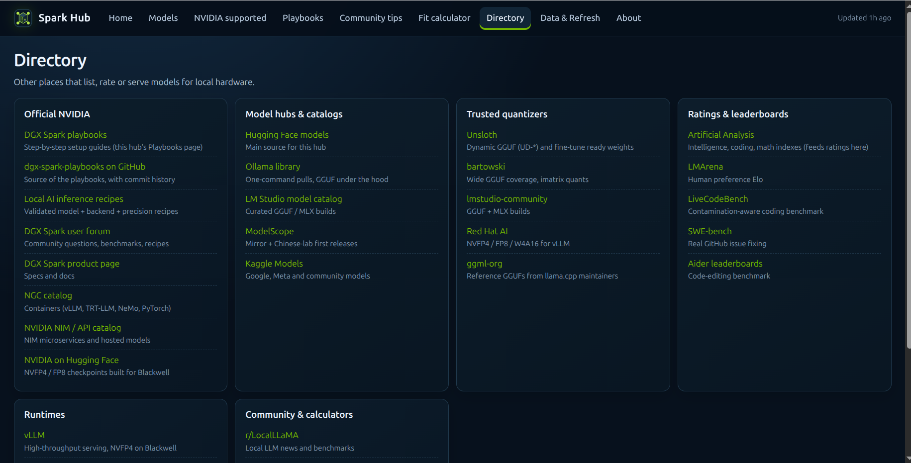

# Spark Hub Screenshot Gallery

Screenshots of the dashboard and its features.

## Dashboard

### Home screen

### Models screen

### NVIDIA playbooks

### NVIDIA supported models

### Community tips

### Directory

### Fit calculator

## Data and refresh

### Data refresh overview

### Data sources

### Run monitor

### Refresh history

### Automatic refresh schedule

## About Spark Hub

